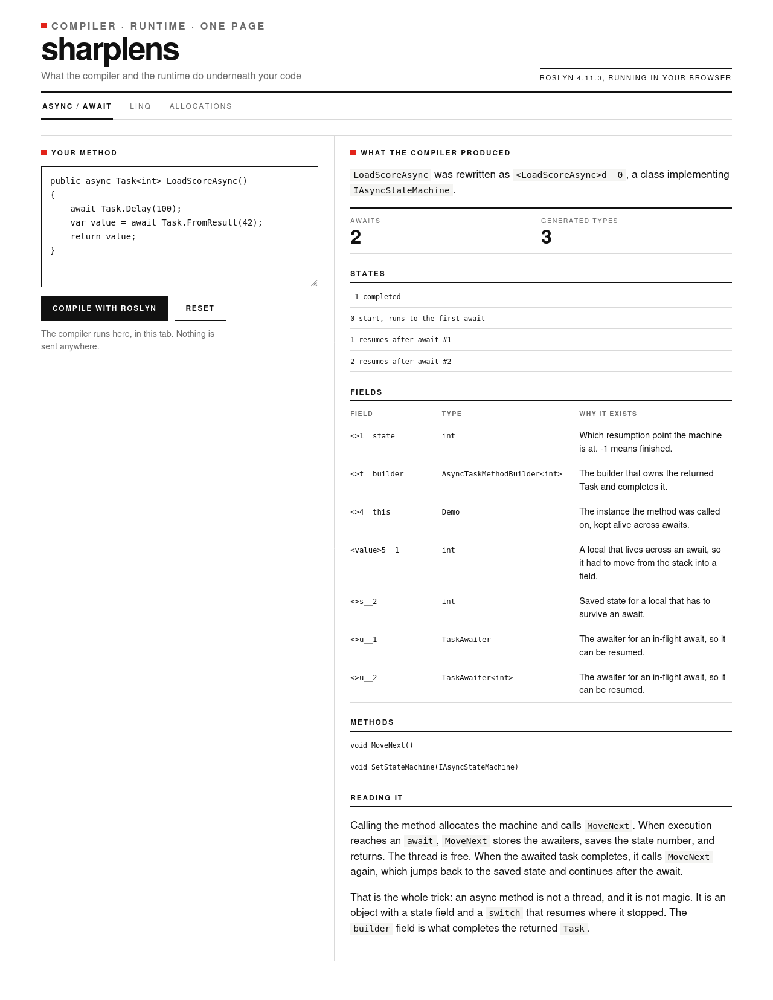
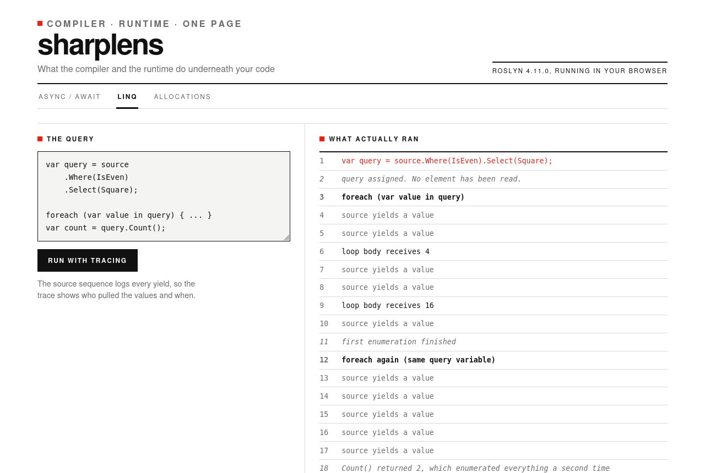

# sharplens

See what C# and .NET actually do underneath your code. Roslyn runs in the browser, and the page shows you what it produced.



## Three scenes

**async / await.** Type a method, compile it, and read the state machine the compiler generated. Every field is explained: the resumption point, the builder that owns the returned task, the reference that keeps `this` alive across an await.

**LINQ.** A query that logs every yield, so you can see that building it reads nothing and that each `foreach` starts over.

**Allocations.** Four workloads measured with the runtime's own counter. Concatenating a string ten thousand times costs about 100 MB; the same work with a `StringBuilder` costs 33 KB.



## Run it

Needs the .NET 8 SDK.

```bash
git clone https://github.com/TamiloreO/sharplens.git
cd sharplens
dotnet run --project src/Sharplens.Web
```

## Tests

```bash
dotnet run --project tests/Sharplens.Tests
```

Nineteen checks covering the compiler inspection, the LINQ trace and the measurements.

## Worth knowing

Your code is compiled, not executed, so nothing you type runs in the page. The numbers are real for this runtime, which is single threaded WebAssembly rather than desktop .NET. The site is 52 MB on disk and about 8 MB over the wire with Brotli, so the first visit is not free.

The look borrows the swiss skin from [style-labs](https://tamiloreo.github.io/style-labs/?s=swiss).

[MIT](LICENSE) © Oluwatamilore Olufohunsi
